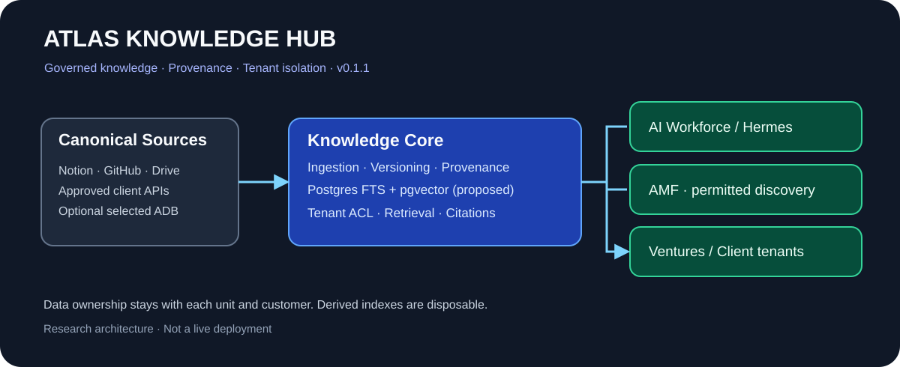
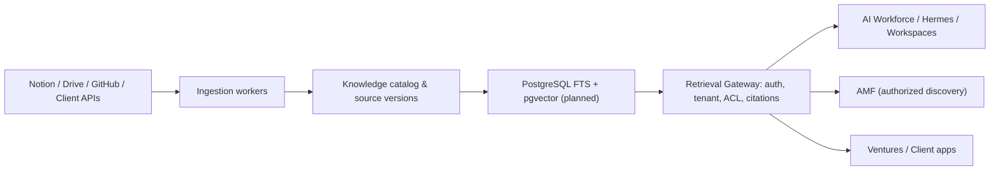

# Atlas Knowledge Hub (AKH)

> **AtlasHub · Knowledge infrastructure for the Augmented Enterprise**  
> **Baseline v0.1.1 · 2026-10-10 · Public architecture / engineering foundation · Status: proposal + tested policy prototype, NOT deployed**

The **Atlas Knowledge Hub** is the governed, reusable knowledge layer consumed by people, AtlasHub AI Workforce / Hermes agents, Atlas Media Factory (AMF), independent ventures, workspaces and customer deployments. **Not another company, agent orchestration platform, generic chat app or replacement for Notion/Drive/GitHub.**

**Start here:** [Documentation map](docs/INDEX.md) · [Architecture](docs/02-architecture.md) · [Decision log](docs/10-decisions-and-alternatives.md) · [Delivery roadmap](docs/11-roadmap.md) · [Agents' reading guide](AGENTS.md) · [Change log](CHANGELOG.md).

## Core promise

**Find the right source, at the right version, for the right user or agent, without crossing organizational boundaries.**

| Area | Canonical authority | AKH responsibility |
| --- | --- | --- |
| Corporate decisions and editorial governance | Notion | Register sources, retrieve approved fragments |
| Code, policies, Agent Packs, migrations | GitHub | Reference and index permitted revisions |
| Media masters and final assets | Drive / approved DAM | Searchable asset metadata and authorized references |
| AMF campaigns, versions, approvals, schedules, analytics | AMF Factory PostgreSQL | Read-only governed discovery; never fork operational state |
| AI Workforce tenants, deployments, tool grants | AI-WaaS control plane | Tenant-resolved retrieval via policy-enforced API |
| Sectoral and jurisdictional knowledge | Curated, attributed source catalog | Reusable, versioned content with locale/jurisdiction rules |
| Client knowledge | Client-controlled connected sources | Private tenant-scoped ingestion and retrieval |
| Live CRM, inventory, bookings and prices | Source operational system | Tool/API lookup, **not stale RAG** |

## Architecture at a glance





[Full design and alternative architectures](docs/02-architecture.md).

## Repository layout

| Path | Purpose |
| --- | --- |
| [docs/INDEX.md](docs/INDEX.md) | Reading paths for directors, developers, security and agents |
| [docs/](docs/INDEX.md) | Vision, stack, governance, ingestion, retrieval, media, examples, decisions, roadmap |
| [docs/adr/](docs/adr/ADR-0001-knowledge-core.md) | Versioned Architectural Decision Records |
| [schemas/](schemas/README.md) | **Proposed** DDL, not migration-ready |
| [contracts/](contracts/knowledge-source.schema.json) | Typed interchange manifests for sources and requests |
| [src/](src/policy.mjs) | Runnable reference policy/selection implementation; not an API |
| [test/](test/policy.test.mjs) | Node built-in policy tests |
| [examples/](examples/synthetic-sources.json) | Non-sensitive synthetic domain + client records |
| [CHANGELOG.md](CHANGELOG.md) | Analysis evolution and implementation milestones |

## Quick start — reference code only

```bash
node --version # Node 20+
npm test
npm run demo
```

These commands exercise in-memory access control and simple retrieval decisions using synthetic examples. **No database, embeddings, remote connector, server, login or production ingestion has been deployed by this repository.**

## Scope and integration boundaries

- **[AtlasHub AI Workforce](https://github.com/atlashub-digital/AtlasHub-AI-WaaS)**: existing managed-service control plane; tenant identity and permissions must be independently verified in the AKH gateway.
- **[Agent Packs](https://github.com/atlashub-digital/atlas-agent-packs)**: reusable roles/guardrails. An Agent Pack refers to jurisdictional and client knowledge bindings, never embeds customer data in public Git.
- **[Atlas Media Factory](https://github.com/atlashub-digital/atlas-internal-factory)**: editorial truth in Notion, binary masters in Drive, execution in its own Factory PostgreSQL. Independent Holding unit; AKH is shared technical infrastructure only under authorization.
- **[Atlas Device Bridge](https://github.com/atlashub-digital/Atlas-Device-Bridge)**: optional permitted device-based source capture; always explicit consent, source ACL and audit.
- **[Notion Knowledge Governance](https://app.notion.com/p/764652fc5b9d8390a53101f25bcf4c1d)**: Draft → Review → Verified → Published → Archived; classification controls survive indexing.

## Non-negotiable safeguards

1. Deny by default; **enforce authorization before retrieval** and before sending text to an LLM. Never rely solely on the agent prompt to isolate a tenant.
2. No cross-client knowledge reuse without explicit entitlement. AMF, ventures and AtlasHub.SI retain their own content ownership.
3. Never commit client files, patient data, private Drive URLs, personal records, API tokens, infrastructure IPs or secrets. Synthetic fixtures only while public.
4. No autonomous medical advice, legal determinations, unapproved marketing claims, publishing or financial effects.
5. Distinguish **idea/proposal**, **approved policy**, **implemented/tested**, **staging** and **production**. This repository is an architecture baseline, not commercial proof.

## Current implementation status

- **Documented:** proposed architecture, options, entity model, threat model, retrieval and ingestion contracts.
- **Executable here:** pure-JS policy/reference tests with fake sources; no external dependencies.
- **Not implemented:** Supabase migrations, live connectors, FTS+vector hybrid engine, auth gateway, Hermes binding, DAM synchronizer, production observability.

**Next gate:** security review of existing Supabase roles/grants and owner mapping; freeze API contract; then implement one end-to-end Notion/GitHub/Drive fixture ingestion on isolated staging with tenant A/B denial tests.

## Versioning and feedback

Use SemVer for engineering releases, numbered ADRs for decisions, and date-stamped [analysis log](docs/analysis-log.md) for evolving assumptions. Open GitHub issues using the templates rather than silently rewriting decisions. Direct commits to main at bootstrap were authorized; future production changes should pass reviews and CI.

> Public repository temporarily by owner request. Public means **anyone on the internet can read all content and its Git history**. Restrict contents immediately; changing visibility later does not erase historical disclosures.
