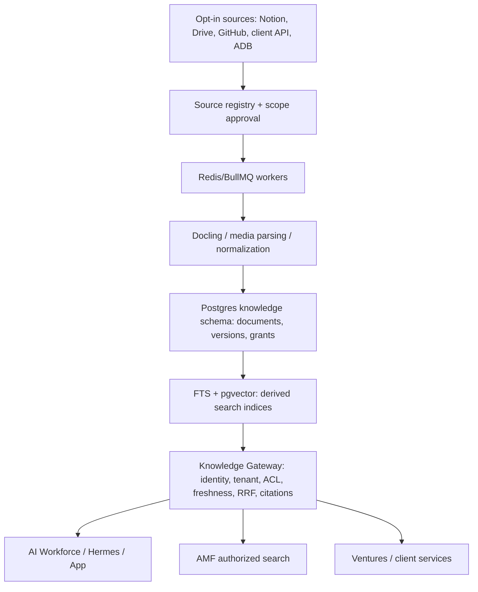

# AKH-ARCH-001 · Target architecture and evaluated stacks

**Status:** PROPOSED. Existing AtlasHub Supabase project: known, pgvector available but **not verified installed** at baseline. No AKH service deployed.

## Layered architecture

## Preferred MVP (option A)
- PostgreSQL in AtlasHub Supabase as proposed *private knowledge schema*; managed auth for users, tenant policy in backend and DB; pgvector + Postgres tsvector/GIN, optional RRF.
- NestJS/TypeScript API consistent with current engineering capability; isolated ingestion worker (Python + Docling where valuable), BullMQ/Redis queue.
- Drive is initial AMF DAM, Notion editorial registry, GitHub code/agents; object storage for approved immutable publication assets when needed.
- Transport: REST/OpenAPI first, MCP thin adapter later; publish stable typed retrieval API.
- Provenance: source_id, owner_org, tenant_scope, ACL snapshot, content_hash, source_version, classification, locale, jurisdiction, valid_from/to, sync status.
- Binary content remains in its governing store; only approved derived extracts and references are indexed.

## Alternatives (not silently rejected)
| Option | Benefits | Risks / condition |
| --- | --- | --- |
| **A: Supabase PG + pgvector + FTS** | existing stack, ACL-aware joins, low component count | DB load, embedding migration, RLS discipline |
| B: Dedicated Postgres AKH | isolation, scaling, clear SLO | separate backup, auth, operations |
| C: Qdrant + relational catalog | vector scale, filters | dual-store consistency and ACL complexity |
| D: OpenSearch / Elastic | advanced lexical search | infrastructure and ops cost |
| E: RAGFlow/LlamaIndex as main platform | ready ingestion/RAG tooling | product coupling, tenant-security adaptation |
| F: Knowledge only in Notion/Drive | lowest initial build | cannot provide unified permissions, retrieval quality and live state |

Promotion rule: choose A until observed performance/security evidence invalidates it. Re-evaluate at volume/SLO and customer residency thresholds, never by fashion.

## Deployment topology
- Vercel (optional) for portal/UI only; do not put sensitive long-running parsers in public request paths.
- API/worker isolated container runtime on approved Atlas infrastructure or dedicated host. No concrete VPS address, topology secret or privileged route published.
- Supabase AtlasHub schema **only after security review**; AMF Factory remains autonomous, connected by permissions-scoped adapter.
- Independent client deployments may run a portable package with separate database and storage.

## Data flows
1. Source owner grants scoped sync. Store references and version.
2. Worker detects delta; downloads authorized bytes; scans/normalizes/chunks; records provenance; indexes.
3. Caller authenticates; server resolves tenant and agent permissions from trusted binding, not caller text.
4. Restrict authorized universe **before ranking and before LLM**; choose direct operational tools when source is live.
5. Return snippets, citations, freshness, safe metadata and policy decision audit.
6. Source revoke/delete invalidates embeddings, cache, materialized extracts and downstream entitlements.

## Compatibility
Existing AI Workforce roles/deployments/ToolGrant remain authoritative for execution. AKH never executes tools and never decides that a pack is approved. AMF retains its Factory run/approval/delivery tables. See [domain boundaries](03-data-ownership.md).
