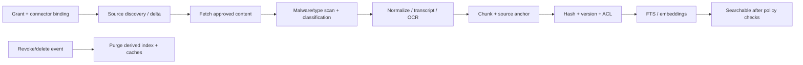

# AKH-ING-001 · Controlled ingestion and media processing

**Status:** PROPOSED.

## Pipeline

## Connector contract
Each source adapter implements list_changed(cursor), fetch_version(item, principal), map_permissions(item), detect_deleted(cursor), revoke(scope), health. Support rate limits, retry with jitter, idempotency by source_id/version/hash, dead-letter errors, and partial failures. Do **not** ingest all documents simply because an OAuth token can list them.

## Formats and candidate tools
- HTML/Markdown/plaintext: safe sanitize, preserve title/sections/hyperlinks.
- PDF/Office: [Docling](https://github.com/docling-project/docling) as candidate; test multi-column, tables and languages on real approved examples.
- Audio/video: transcription + timecoded spans, media length, speaker uncertainty; optional safe keyframe descriptions. **Never persist raw customer recordings without consent.**
- Images: OCR only when rights and need justified; metadata first.
- Source snapshot: immutable hash and origin pointer. Extracts can be reprocessed; originals remain owned by origin.

## Freshness and invalidation
- Static policy: webhook/change feed and periodic reconciler.
- Listings, stock, prices, bookings, clinic schedules: read live API, **do not pretend an indexed document is current**.
- Regulatory facts: validity ranges, effective law versions, verified primary-source checks and reviewer.
- Deletions, entitlement revocation, classification downgrade: priority invalidation; zero reliance on nightly-only sync.

## Quality gates
Conformance to source ACL and provenance; duplications removed; corrupted extractions quarantined; field-level PII minimization; red-team prompt-injection fixtures; no publication of Draft/Restricted data by default. Keep ingest failures observable.

## Device Bridge
May offer opt-in selection of local files only; bridge receives a limited ingest token for approved source IDs. ADB cannot grant access to another tenant's knowledge. See [cross-repository](https://github.com/atlashub-digital/Atlas-Device-Bridge).
