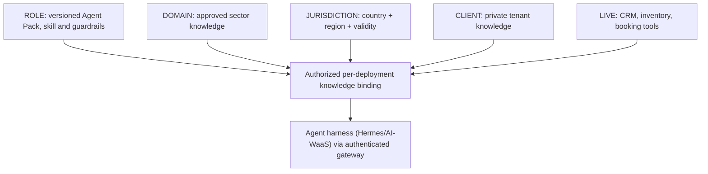

# AKH-AGENT-001 · Role + Domain + Jurisdiction + Client + Live State

**Status:** PROPOSED; no training/fine-tuning in this baseline.

## Composition

Agent *identity/memory* differs from *versioned reference knowledge* and *live operational facts*. Personal conversational memory is not a regulatory or client source of truth.

## PACK-004 · real estate
Already exists as `real-estate-consultant` in [atlas-agent-packs](https://github.com/atlashub-digital/atlas-agent-packs/tree/main/packs/real-estate-consultant), demo status. Propose bindings to domains/real-estate/PT/Lisboa or BR/GO, plus private customer tenant corpus and listing CRM tool. **Prices/availability from CRM only**. Visits approval, negotiation and offers human-controlled per pack guardrails. Reuse domain library only with explicit license/entitlement, without copying client portfolios into shared libraries.

## PACK-001 · clinic receptionist
[clinic-appointment-confirmation](https://github.com/atlashub-digital/atlas-agent-packs/tree/main/packs/clinic-appointment-confirmation) is a demo pack, not a deployed medical assistant. Its administrative knowledge may include office workflow, appointment rules and published service information. Clinic-specific doctors/hours/prices belong in private client sources; patient records stay in permissioned clinical systems with purpose limitation. Never diagnose, prescribe, independently triage emergencies or turn RAG content into medical authority. Escalate to staff.

## Other alternatives
- Legal receptionist: taxonomy, deadlines as **reviewed**, lawyer handoff; no personalized legal advice.
- E-commerce support: policy KB for returns, live order API for order status, verified product inventory.
- Media editor: reuse AMF-approved brand voice and claims, read approved DAM versions; never autonomously publish.

## Agent binding manifest
See [JSON schema](../contracts/agent-knowledge-binding.schema.json). Every deployment pins pack version, approved library IDs, country/locale, tenant, trusted role scopes, source freshness and prohibition matrix. Public demos use synthetic data only.

## Evaluation questions
Does agent cite correct source? Refuse out-of-scope jurisdictions? Abstain on stale price? Refuse cross-tenant search? Uphold role guardrails even when retrieved document requests otherwise?
