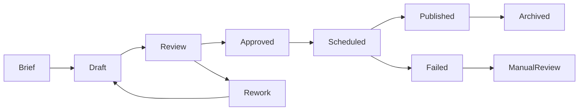

# AKH-AMF-001 · Atlas Media Factory & Digital Asset Management

**Status:** PROPOSED integration with **existing** AMF architecture; no duplication of Factory operations.

## Observed canonical architecture
- Notion AMF: editorial strategy, Campaign Briefs, Editorial Calendar, Approved Content Library, Sources & Claims, Personas & Voice.
- Google Drive: original/master binaries, initial DAM.
- Factory PostgreSQL private `factory` schema: `projects`, `runs`, `tasks`, `source_snapshots`, `artifacts`, `artifact_versions`, `reviews`, `approvals`, `cost_events`, `delivery_events`, `analytics_snapshots`, `learning_events`, `audit_events`.
- [AMF technical repo](https://github.com/atlashub-digital/atlas-internal-factory) remains implementation truth. This AKH repository **must not** define a competing campaign or publication state machine as canonical.

## Suggested creative lifecycle

A scheduled post must pin immutable artifact_version/hash, approval ID, channel/account, planned date/time, operator action and idempotency key. Changing bytes/copy/claim invalidates inherited approval for the new version. Publication adapters and state run in the **Factory**, not AKH.

## AKH integration surface
Read-only `media.search` by approved library permissions: asset_id, campaign, project, kind, locale, dimensions, rights/license, channel, editorial status, version/hash, provenance, thumbnail if entitled, checksum, expiry. Signed URLs short-lived; client content does not enter public indices. An AKH document points to the original asset; it does not become a master.

## Storage recommendation
Keep Drive as authoring/master DAM in phase 1. Consider immutable approved rendition in tenant-scoped S3-compatible or Supabase Storage when an approved posting adapter needs bounded binary access; record mapping in Factory artifacts. Compare later dedicated DAM only after real retrieval/rights needs.

## Recommended schema evolution *in AMF repo*
Before adding `publication_jobs`, audit existing `delivery_events`, `approvals` and scheduler model. Propose migration/ADR in AMF, not AKH; avoid silent schema overlap.

## First pilot
LeveLab/LIA pilot is documented within AMF but shares no unrestricted asset ownership with corporate or other tenants. Verify one approved creative, one version change, one denied publication and one retrieval by permitted operator.
